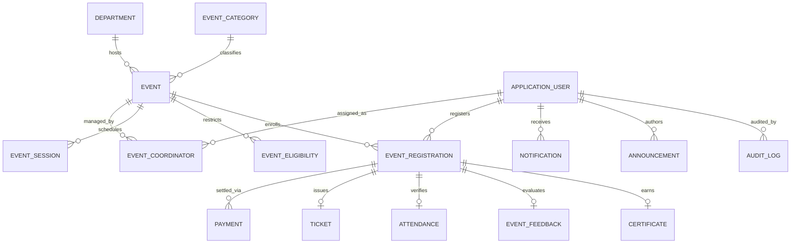

# VAP UNIVERSITY — Campus Event Hub
# System Architecture & Technical Specifications

This document details the architectural layers, domain patterns, data flow models, background processing infrastructure, and external subsystem integrations of the **VAP UNIVERSITY Campus Event Hub**.

---

## 1. Architectural Philosophy: Clean Architecture

The solution adheres strictly to **Clean Architecture** (Ports and Adapters), ensuring that core domain logic, entities, and business rules remain decoupled from frameworks, database providers, and user interfaces.

```
       +-------------------------------------------------------+
       |               Presentation Layer                      |
       |         CollegeEventRegistration.Web                  |
       |  (MVC Controllers, Razor Views, SignalR Hub, Assets)  |
       +---------------------------+---------------------------+
                                   |
                                   v
       +-------------------------------------------------------+
       |               Infrastructure Layer                    |
       |      CollegeEventRegistration.Infrastructure          |
       |   (EF Core 10, SQL Server, Identity, PDF, Email)      |
       +---------------------------+---------------------------+
                                   |
                                   v
       +-------------------------------------------------------+
       |                  Core Domain Layer                    |
       |           CollegeEventRegistration.Core               |
       |      (Entities, Enums, DTOs, Service Interfaces)      |
       |              [Zero External Dependencies]             |
       +-------------------------------------------------------+
```

### Layer Responsibilities
1. **CollegeEventRegistration.Core:**
   - Contains pure C# domain entities (`Event`, `EventRegistration`, `Payment`, `Ticket`, `Attendance`, `Certificate`, `EventFeedback`, `Announcement`, `Notification`, `AuditLog`).
   - Declares service interfaces (`IEventManagementService`, `IPaymentService`, `ITicketService`, `IAttendanceService`, `ICertificateService`, `IAnalyticsService`, `IReportExportService`, `IEmailService`, etc.).
   - Defines domain enums, status transitions, and data transfer objects (DTOs).
   - Contains zero NuGet dependencies on web or persistence frameworks.

2. **CollegeEventRegistration.Infrastructure:**
   - Implements data persistence via `ApplicationDbContext` (EF Core 10 on SQL Server 2025 Express).
   - Manages ASP.NET Core Identity tables and role stores.
   - Implements third-party adapters: QuestPDF engine, QRCoder matrix generator, Razorpay test gateway client, SMTP email dispatcher, and background email queue.
   - Enforces optimistic concurrency (`RowVersion`), execution strategies, and relational invariants.

3. **CollegeEventRegistration.Web:**
   - Composition root and entry point (`Program.cs`).
   - ASP.NET Core MVC controllers split into 4 distinct areas: `Student`, `Coordinator`, `Admin`, `SuperAdmin`, plus root public controllers (`HomeController`, `AccountController`, `CertificatesController`).
   - Houses Razor layouts (`_Layout.cshtml`, `_DashboardLayout.cshtml`, `_StudentPortalLayout.cshtml`), static CSS/JS, and real-time SignalR hubs (`NotificationHub`).

---

## 2. Relational Database Architecture



### Critical Database Invariants
- **Registration Capacity Guard:** `Event.TotalCapacity` and `Event.RegisteredCount` enforced with `RowVersion` concurrency checks.
- **Single Ticket Invariant:** `IX_Tickets_RegistrationId` unique constraint ensures exactly one admission pass per registration.
- **Single Check-In Invariant:** `IX_Attendances_RegistrationId` unique index guarantees duplicate scans are rejected at the database level.
- **Single Feedback Invariant:** `IX_EventFeedbacks_RegistrationId` unique index enforces exactly one evaluation per attendee.
- **Single Active Certificate Invariant:** `IX_Certificates_RegistrationId` unique constraint prevents duplicate credentials.
- **Replay Attack Defense:** `UX_Payments_TransactionId` unique index prevents reusing gateway payment IDs.

---

## 3. Core Business Workflows

### 3.1 Event Lifecycle State Machine
```
[Draft] ---> (Submit) ---> [PendingApproval] ---> (Reject with Reason) ---> [Rejected]
                                |                                              |
                                | (Approve)                                    | (Resubmit)
                                v                                              v
                           [Approved] -----------------------------------------+
                                |
                                v
                           [Published] ---> (Close/Complete) ---> [Completed]
                                |
                                +---> (Cancel) ---> [Cancelled]
```

### 3.2 Registration & Payment Flow
1. **Student Registration:** Free events transition directly to `Confirmed` and increment `RegisteredCount`. Paid events initialize in `Pending` without taking seats.
2. **Checkout Terminal:** Generates order via `PaymentService.InitiatePaymentOrderAsync` and renders payment portal.
3. **Gateway Verification:** Server independently validates HMAC-SHA256 signature (`VerifyAndConfirmPaymentAsync`), atomically reserves seat with EF Core execution strategy, transitions registration to `Confirmed`, and dispatches confirmation notifications.

### 3.3 Attendance & Live Scanner Flow
1. **Camera Stream:** Browser initiates live camera feed via `html5-qrcode` (webcam or mobile rear camera with `facingMode: "environment"`).
2. **QR Detection:** Scanner decodes tamper-proof JSON payload and sends AJAX request to `/Coordinator/Attendance/CheckInQr`.
3. **HMAC Verification:** Server verifies cryptographic signature in constant time, verifies coordinator event assignment, ensures registration is confirmed and paid, and checks for prior check-ins.
4. **Admission Recording:** Atomically marks `Ticket.IsUsed = true`, creates `Attendance` record, and returns admission badge.

### 3.4 Certificate Issuance & Verification Flow
1. **Eligibility Evaluation:** Requires confirmed registration, verified payment, event completion, and verified attendance.
2. **Server-Side Rendering:** QuestPDF compiles personalized A4 landscape PDF certificate in memory and writes to private storage `App_Data/Certificates/`.
3. **Public Verification:** Anyone can query `/Certificates/Verify/{identifier}` to verify credential authenticity and view student/event metadata.

---

## 4. Background Processing & Real-Time Push

### 4.1 Asynchronous Email Channel Queue
- Utilizes .NET `System.Threading.Channels.Channel<EmailMessage>` for high-throughput, non-blocking email buffering (`EmailBackgroundQueue`).
- Background consumer (`QueuedEmailBackgroundService`) runs as a hosted background service, dequeuing and sending messages asynchronously.
- Handled with graceful fallback: if SMTP is unconfigured, logs a structured warning without failing web requests or breaking database transactions.

### 4.2 SignalR Real-Time Notifications
- SignalR hub `NotificationHub` mapped to `/hubs/notifications`.
- `SignalRNotificationPublisher` targets authenticated user sessions using `Clients.User(userId)`.
- Client-side listener updates the unread badge counter dynamically and pops toast alerts when new notifications arrive.
